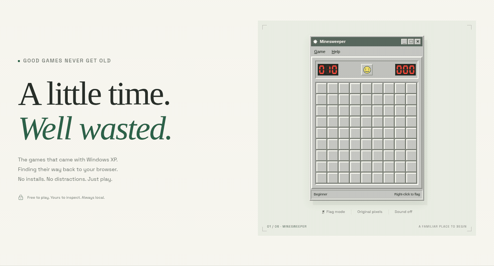

[Open the local build](http://localhost:4179) · No public deployment yet.

# Stillplay

**A little time. Well wasted.** Minesweeper and FreeCell, made for a browser and a quiet break.



[](scoreboard/minesweeper.json)
[](scoreboard/freecell.json)

Stillplay is a playable prototype of the games that came with Windows XP, using our own code and artwork. The long-term project is a function-by-function, byte-matched reconstruction with public evidence. **No original executables have been supplied, so no original function, byte, or deal layout is verified yet.** The current C/WebAssembly games are our own implementations.

## Play locally

Requires Node 24 and pnpm 11. Use the repository's pinned package-manager version.

```sh
pnpm install --frozen-lockfile
pnpm dev --port 4179
```

Open [localhost:4179](http://localhost:4179). The home page opens directly into Minesweeper. FreeCell, daily challenges, Secrets and the evidence scoreboard are available from the site navigation. Preferences and game records remain in your browser.

To rebuild the C cores and serve the static output, also provide LLVM Clang with the `wasm32` target and `wasm-ld` on PATH (or select Clang with `CLANG=/path/to/clang`):

```sh
pnpm build
pnpm preview --port 4179
```

The site shell lives in `src/site/`: `router.js` derives every route from the registry in `src/games.js`, `pages/` holds one module per page, `play/stage.js` wraps a game in its controls (new game, undo, hint, daily, sound, drawing mode, stats, focus mode, shortcuts), and `play/stats.js` keeps local stats and daily streaks. A registry entry with `mount: null` shows as coming soon; giving it a `mount` makes it playable with no shell changes. `pnpm build` also prerenders each route's first screen, writes per-route metadata, JSON-LD, Open Graph PNGs, `sitemap.xml`, `robots.txt` and an offline service worker (`--no-cores` reuses the committed WASM; `SITE_URL` sets the absolute origin). `pnpm icons` regenerates the install icons.

Game logic lives in `cores/*.c`, is compiled to `cores/*.wasm`, and is loaded by the browser and the Node CLI. See `scripts/build.mjs` for compiler detection and exact flags. The included WASM lets the development server run without a system-wide compiler installation. This modern LLVM browser build does not reproduce an original Windows compiler toolchain.

## What is verified

| Game | Verified original functions | Original function total | Verified original bytes | Byte-match percentage |
| --- | --- | --- | --- | --- |
| Minesweeper | 0 | Unknown | 0 | Not measured |
| FreeCell | 0 | Unknown | 0 | Not measured |

The machine-readable source of truth is [`scoreboard/minesweeper.json`](scoreboard/minesweeper.json) and [`scoreboard/freecell.json`](scoreboard/freecell.json). Unknown denominators are `null`; the site must not turn them into a percentage. Original inputs remain outside this repository. No differential result is asserted before we can run the original and this build with the same inputs.

Each file also indexes the actual functions in our own C prototype separately. That code index has no original addresses or sizes and contributes nothing to the original match totals.

The current local tests exercise our implementation: deterministic seeds and replays, legal state transitions, first-click safety, and card/deal invariants. They do not establish equivalence to Microsoft's originals.

```sh
pnpm test
pnpm verify:scoreboard
pnpm test:browser
pnpm lighthouse
```

Browser checks use Chromium with at most two workers. Builds, browser checks and Lighthouse use the shared two-job heavy-work wrapper. The measured results below describe this local build; they do not establish original-binary equivalence.

## Headless play

The `xpc` CLI runs the same WASM cores in Node. Commands are deterministic and emit JSON suitable for agents.

```sh
pnpm xpc minesweeper new --level expert --seed 42 --json
pnpm xpc minesweeper click 3 4 --json
pnpm xpc freecell deal 11982 --json
pnpm xpc freecell move c0 f0 --json
pnpm xpc replay export game.json
pnpm xpc replay load game.json --json
```

Commands save state in `.stillplay-state.json` by default; use `--state /path/to/state.json` to isolate sessions. Replays contain a schema version, game configuration and ordered inputs; see [`docs/replay-format.md`](docs/replay-format.md). This is the foundation for shareable games and a future replay-verified agent leaderboard. A public leaderboard and stdio MCP server are later work.

## Original files and artwork

The repository includes our original vector/code-drawn art and authored code. It includes no Microsoft game bitmap, icon, sound, theme resource, original executable or Pinball data. The local file tool inspects supplied PE resources in your browser, computes a SHA-256 and previews supported BMP resources without uploading or executing the file. It does not yet render those resources as an authentic playable game skin.

We have not established a clean-room reconstruction process. We do not claim access to the original source. Future original-binary verification needs lawfully supplied files and a legitimate matching compiler toolchain; hashes and function comparisons will be recorded when those inputs exist.

**Not affiliated with or endorsed by Microsoft.** “Windows XP” is used only to describe the historical games.

## Roadmap

| Wave | Games | Status |
| --- | --- | --- |
| 1 | Minesweeper + FreeCell | Playable local prototype; original matching and differential verification pending |
| 2 | Solitaire + Spider Solitaire | Planned after wave-one evidence |
| 3 | Hearts | Planned |
| 4 | 3D Pinball | Evaluate the MIT-licensed [SpaceCadetPinball](https://github.com/k4zmu2a/SpaceCadetPinball) source with proper credit and no original data |
| Later | Agent MCP server and replay leaderboard | Planned |

No hosted site, public repository, posting schedule, or final domain has been approved. Stillplay is the working name.

## Local measurements — 2026-10-17

Production static build, Chromium 154.0.8037.57, Lighthouse 13.5.0. Reproduce with `pnpm build`, `pnpm test:browser` and `pnpm lighthouse`. Reports are generated under ignored `notes/`.

| Check | Observed result |
| --- | --- |
| Core, CLI, PE and matching-tool tests | 27 passed, including 3,000 Minesweeper seeds and 3,000 FreeCell deals |
| Browser scenarios | 10 passed, including touch, daily seeds, replays, exact approved PNG comparisons, and 320px phone fit |
| Home Lighthouse | Performance 100 · Accessibility 100 · Best practices 100 · SEO 100 |
| FreeCell Lighthouse | Performance 100 · Accessibility 100 · Best practices 100 · SEO 100 |
| Initial encoded response bodies, including HTML, WASM, fonts and scoreboard JSON | 60,570 bytes |
| Total initial HTTP transfer observed by the browser | 65,070 bytes |
| Playable grid observed on an unthrottled local desktop | 139.1 ms |

Payload was collected through network idle on the production server with Brotli support; FreeCell WASM is lazy-loaded. The board-ready observation is the time of the first playable-grid assertion, not a physical-phone result. Lighthouse used simulated mobile throttling: first contentful paint was 1,204 ms on home and 1,354 ms on FreeCell. The under-one-second playable target on a real mid-range phone remains unmeasured.
