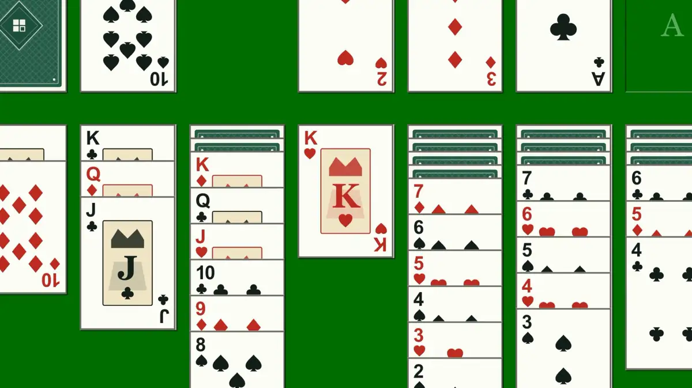
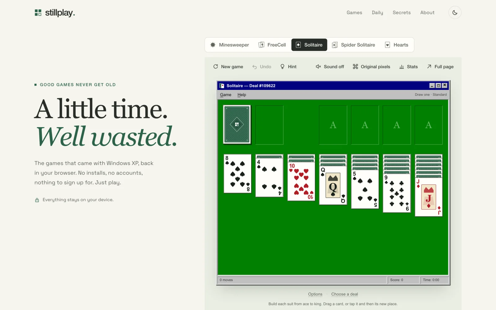
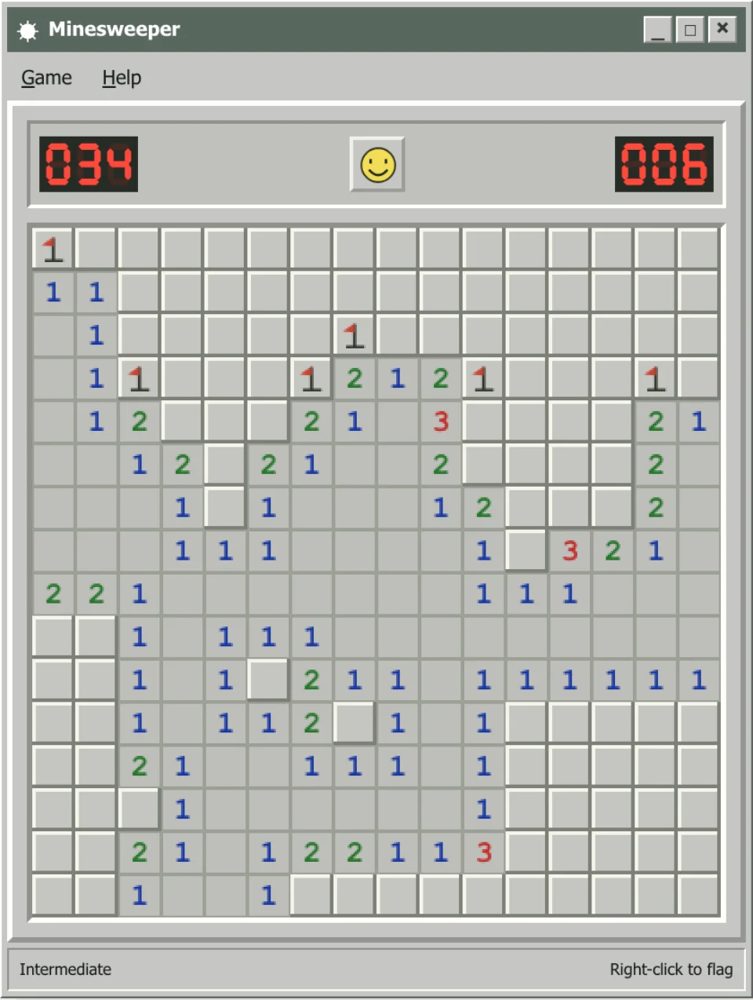
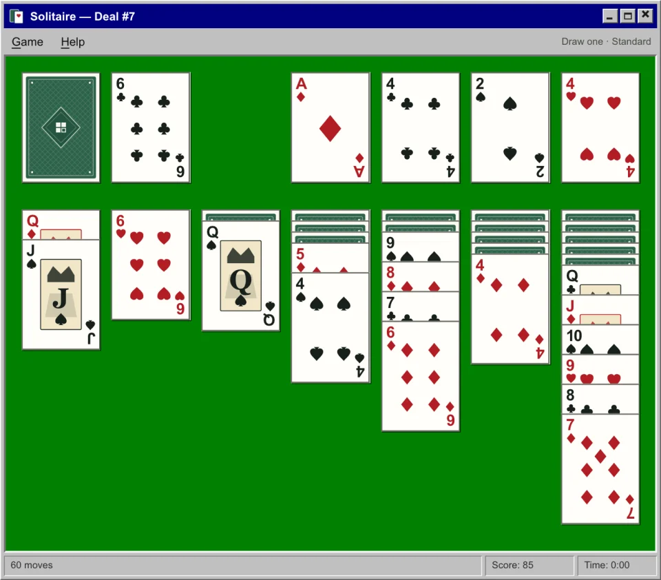
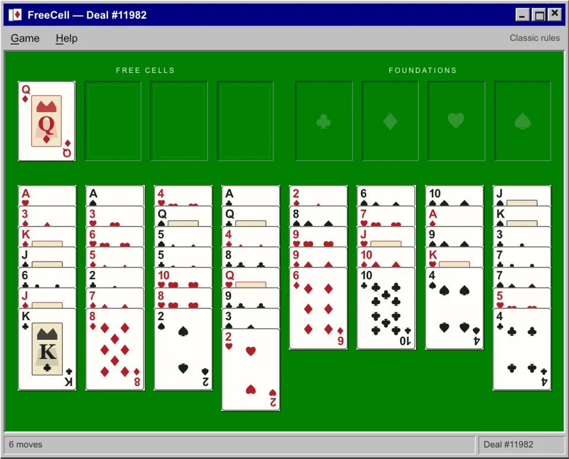
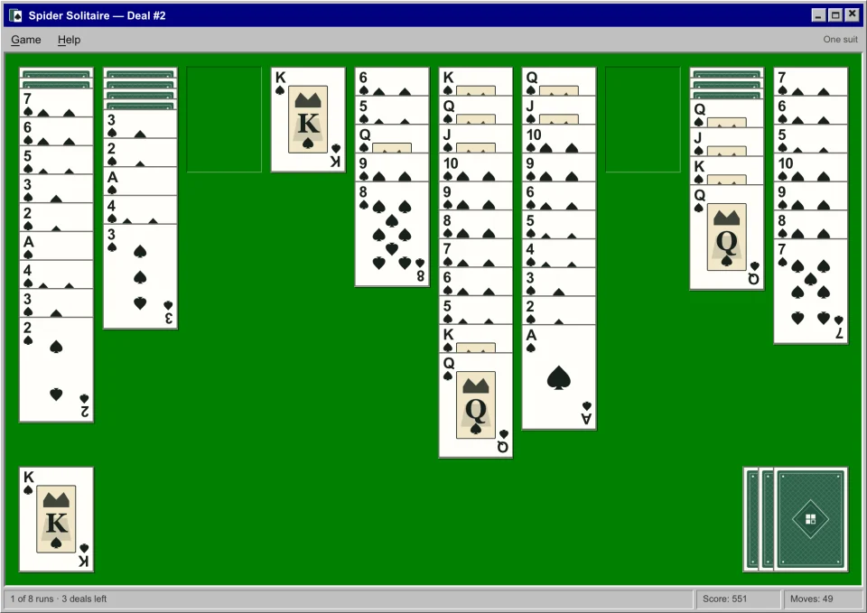
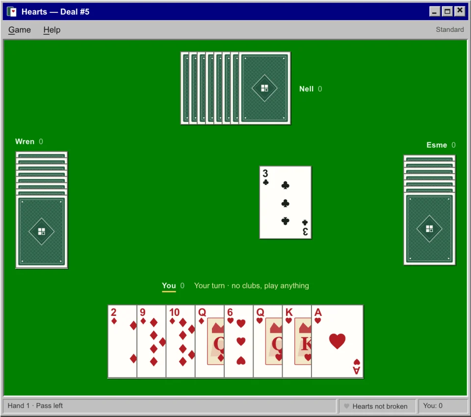

<div align="center">

# stillplay.

**A little time. Well wasted.**

Minesweeper, FreeCell, Solitaire, Spider Solitaire and Hearts, rebuilt for the browser.<br>
Nothing to install, no account, no ads. Works offline once you've visited.

**[Play at stillplay.shiptiffin.app](https://stillplay.shiptiffin.app)**

<sub>Hosted on <a href="https://shiptiffin.com/?ref=stillplay">ShipTiffin</a>: all your apps on one server you own.</sub>



</div>

## The games

<picture>
  <source media="(prefers-color-scheme: dark)" srcset="docs/media/home-dark.webp">
  
</picture>


| | | |
| :---: | :---: | :---: |
|  |  |  |
| **Minesweeper**<br>Beginner, intermediate, expert. Your first click is always safe. | **Solitaire**<br>Draw one or three, standard or Vegas scoring, and the bouncing cards when you win. | **FreeCell**<br>Every numbered deal, including the famous #11982. |
|  |  | |
| **Spider Solitaire**<br>One, two or four suits. Finished runs lift away. | **Hearts**<br>Three computer players who pass, duck and dump points like people do. Watch out for the queen. | |

## What's in the box

- **Real card handling.** Drag a card or a run, tap to pick up and tap to drop, or double-click to send a card home. Moves animate. Illegal drops spring back.
- **Plays by keyboard.** Arrow keys between piles, Enter to pick up and put down, Ctrl/Cmd+Z to undo. Press `?` on any game for its shortcuts.
- **Sound you can feel.** Felt, card and wood sounds, off until you turn them on. The sound file is only downloaded then.
- **A daily for every game.** The same board or deal for everyone, all day, with streaks.
- **Your stats stay with you.** Wins, best times and streaks are kept in your browser. There is no backend and nothing to sign up for.
- **Two looks.** *Original pixels* for the period feel, *Crisp* for sharp modern screens. Light and dark themes.
- **Installable and offline.** Add it to your home screen or dock. After the first visit it plays without a connection.
- **Replays and share links.** Every game is deterministic. Export a replay file, or share a link that replays your exact game.
- **Phone-sized.** Every game fits a 320 px screen and plays by touch.
- **Fast.** About 75 KB to a playable home page. Each game's code and rules load only when you open it. Lighthouse scores 100 in all four categories.

## Play locally

Requires Node 24 and pnpm 11.

```sh
pnpm install --frozen-lockfile
pnpm dev --port 4179
```

Open [localhost:4179](http://localhost:4179). The home page boots straight into a game; the switcher above it changes which one.

## How it's built

There is no framework and no bundler: plain HTML, CSS and ES modules.

- **Rules in C, compiled to WebAssembly.** Each game's rules live in `cores/<game>.c`, written without libc and compiled to a 4–15 KB WASM module. The same module runs in the browser and in Node, so a replay produces the same state in both.
- **One shared card table.** `src/card-table.js` handles drag and drop, tap and keyboard input, move and deal animations, and the win cascade for all four card games. Each game is a thin `src/<game>-ui.js` on top.
- **A registry-driven site.** `src/games.js` lists the collection. Routes, the home page, daily pages, metadata and the sitemap are generated from it. A game with a `mount` is playable; one without shows as coming soon.
- **A static build.** `pnpm build` prerenders every route, writes per-page metadata, JSON-LD and Open Graph images, compresses everything with Brotli and gzip, and generates the offline service worker.

```
cores/        C rules and the compiled .wasm modules
src/          game UIs, card table, card art, audio engine, replay format
src/site/     router, pages, game toolbar, stats, dialogs
scripts/      dev server, build, xpc CLI, browser tests, Lighthouse
tests/        unit and property tests for every core
docs/         core notes and the replay format
```

To rebuild the cores you need a Clang with the `wasm32` target and `wasm-ld`, for example [wasi-sdk](https://github.com/WebAssembly/wasi-sdk). Put it on your PATH or set `CLANG=/path/to/clang`:

```sh
pnpm build
pnpm preview --port 4179
```

`pnpm build --no-cores` reuses the committed WASM. `SITE_URL` sets the absolute origin used in metadata (default `https://stillplay.shiptiffin.app`).

## Headless play

The `xpc` CLI runs the same WASM cores in Node and prints JSON, which makes every game playable by scripts and agents.

```sh
pnpm xpc minesweeper new --level expert --seed 42 --json
pnpm xpc solitaire new --seed 7 --draw 3 --json
pnpm xpc solitaire hint --json
pnpm xpc spider new --suits 2 --seed 7
pnpm xpc hearts new --seed 3 && pnpm xpc hearts hint --json
pnpm xpc freecell deal 11982 --json
pnpm xpc replay export game.json
```

State is saved in `.stillplay-state.json` by default; pass `--state FILE` to keep separate games. Replays are versioned JSON with the game's settings and its ordered inputs. See [`docs/replay-format.md`](docs/replay-format.md).

## Tests

Browser tests, Lighthouse and the build's preview images use Playwright's headless Chromium. Install it once:

```sh
pnpm exec playwright install --only-shell chromium
```

```sh
pnpm test            # 66 unit and property tests
pnpm test:browser    # 41 browser scenarios in headless Chromium
pnpm lighthouse      # Lighthouse on the built site
```

The unit tests play thousands of seeded games per core: they check that cards are conserved and every move is legal, that replays round-trip, and that scoring is right. They also measure the Hearts players (96.7% wins against random play, about 25% each at a four-way table) and how often a simple solver wins one-suit Spider. The browser scenarios drive the real UI with mouse, keyboard and touch, from deal to win cascade, at desktop and 320 px sizes, and compare each game window against approved screenshots.

## The long game: rebuilding the originals

The bigger aim is to reconstruct the original Windows XP games function by function, and to prove each match byte for byte. That needs lawfully supplied original executables and a matching compiler, and that work hasn't started. So today every verified number is zero, and the [scoreboard](scoreboard/) says so. What you play now is our own code, written to behave like the games you remember. It makes no claim to be the original.

[](scoreboard/minesweeper.json)
[](scoreboard/freecell.json)

If you have your own copy, the site's resource inspector can read the bitmaps from a game's `.exe` entirely in your browser. Nothing is uploaded. See [`docs/matching.md`](docs/matching.md) for how matching will work.

## Credits

- Typefaces: [DM Serif Display](https://fonts.google.com/specimen/DM+Serif+Display) and [Space Grotesk](https://fonts.google.com/specimen/Space+Grotesk), both under the SIL Open Font License (licences in `public/fonts/`).
- Sounds: generated for this project with Mirelo SFX and mastered by hand, or synthesised. See [`public/audio/CREDITS.md`](public/audio/CREDITS.md).
- All game art, including the cards, is drawn in code. Stillplay ships no Microsoft bitmaps, icons, sounds or executables.

## Licence

[MIT](LICENSE). Stillplay is an independent project, not affiliated with or endorsed by Microsoft. "Windows XP" is used only to describe the historical games.
